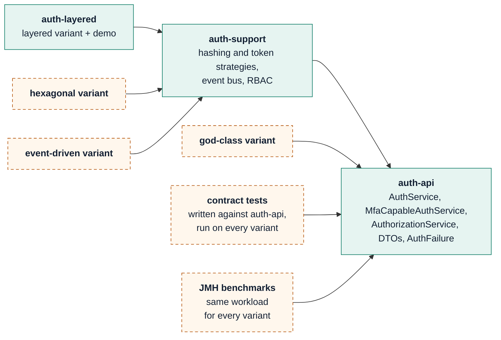
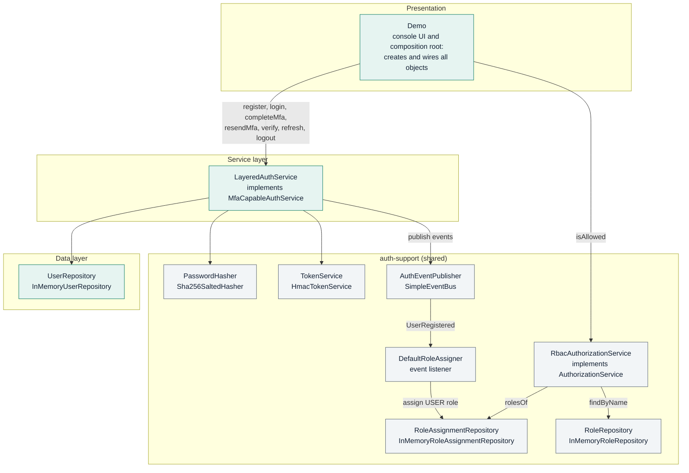
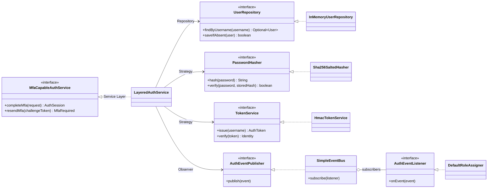
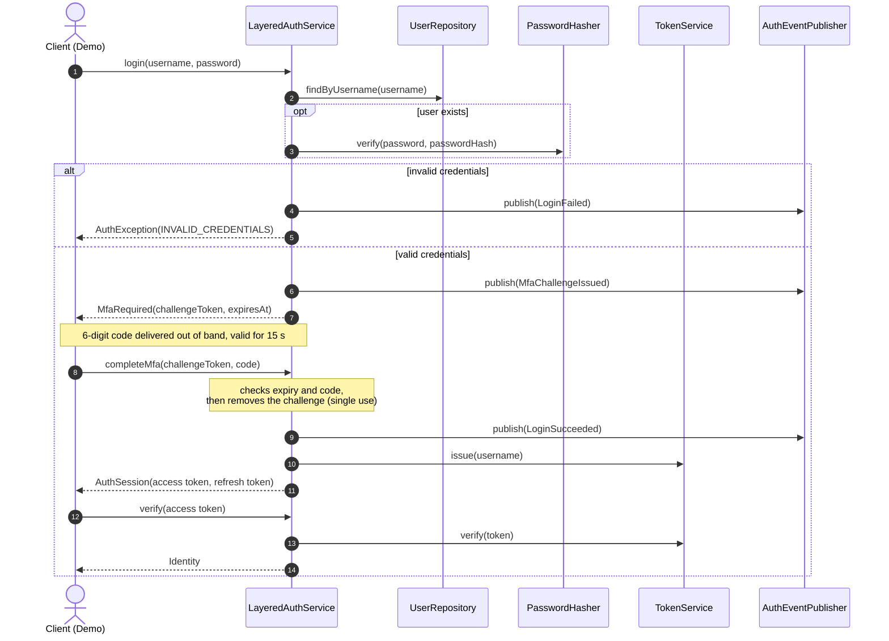
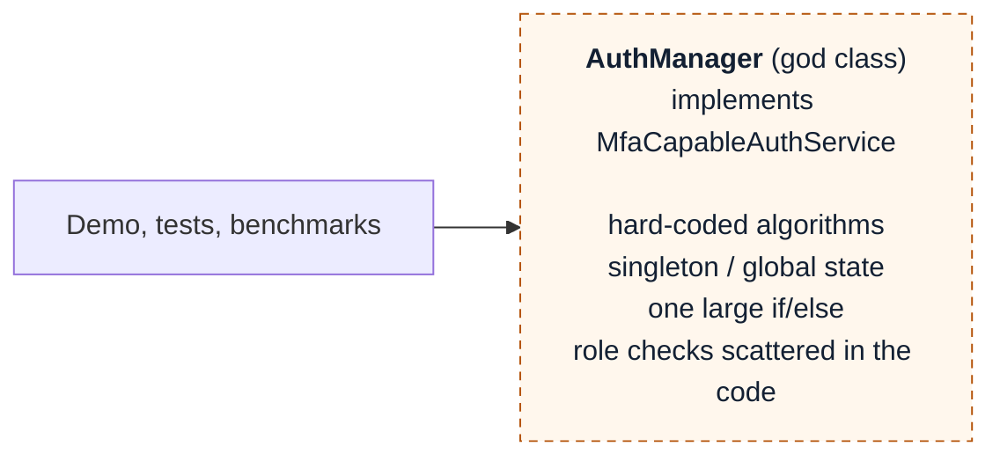
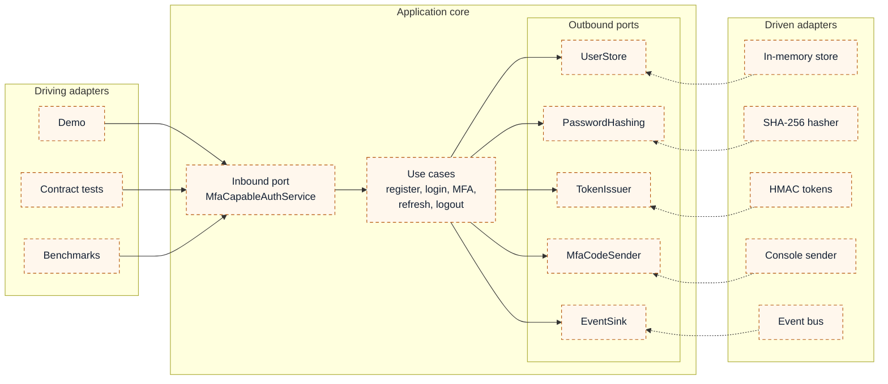
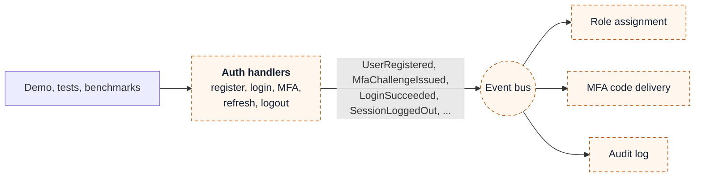

# Architecture

Diagrams for the current implementation and the proposed variants. Solid green boxes are implemented, grey boxes are shared components from `auth-support`, and dashed amber boxes are proposals for M2 that the team still has to confirm.

## 1. Modules

Every variant implements the same `auth-api` contract, so the same tests and benchmarks can run against all of them.

Arrows point from a module to the module it depends on. Tests and benchmarks are written only against `auth-api`; each variant provides a factory for its configured service, so the same suite runs unchanged on every variant. The god-class variant is drawn without `auth-support` because its purpose is to concentrate the logic in one place; it should still use the same hashing and token algorithms so that performance stays comparable.

## 2. Layered variant (implemented)

The demo also wraps the event publisher so that every event is appended to `auth-events.log`, and it supplies the MFA code delivery callback: the callback stores the code and the demo prints it.

## 3. Design patterns in the current code

All collaborators are passed to `LayeredAuthService` through its constructor (dependency injection); `Demo` is the composition root.

## 4. Login with MFA (layered variant)

If a challenge issued at registration is still valid, `login` returns that challenge instead of issuing a new one (no new `MfaChallengeIssued` event).

## 5. Proposed variants (to be confirmed for M2)

The diagrams show the target state. Each new variant first implements the base `AuthService` and gets MFA (change request CR2) in a separate pull request, so that the cost of the change can be measured.

### 5.1 God class (anti-pattern baseline)

As described in the original project plan: a single `AuthManager` that still implements the shared contract, so the same tests and benchmarks apply.

### 5.2 Hexagonal (ports and adapters)

The outbound ports belong to the core: the core defines them and depends only on them. Each dotted arrow points from an adapter to the port it implements.

### 5.3 Event-driven

Whether events are delivered synchronously or asynchronously still has to be decided; it directly affects the latency measurements. If the MFA code travels inside an event, the audit consumer must not record it.
